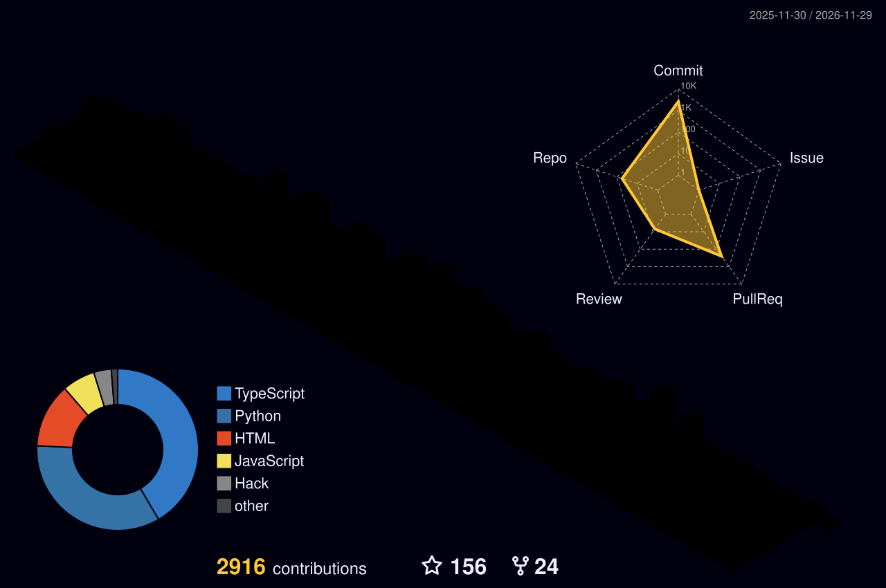

<p align="center">
  
</p>

## Click here to visit my website -> [(www.adityaseth.in)](https://adityaseth.in)


</a>
<a href="https://github.com/AdityaSeth777?tab=followers"></a>
<a href ="https://metrics.lecoq.io/insights/AdityaSeth777"></a>

</p>

```python
Name = "Aditya Seth"
Interests = ["Coding", "Cryptography", "Problem Solving", "Graphic Editing", "Photography", "Exploring various OS :)"]
OS = ["Zorin", "Ubuntu", "BlackArch", "Nitrux", "Windows", "Elementary OS", "Kali Linux", "Ubuntu Unity", "Manjaro", "Arch"]
```

<div align=center>

[](https://github.com/AdityaSeth777)
</div>

## 💼 Experience

| Role | Company | Duration |
|---|---|---|
| 🚀 Software Engineer II (L3), Data & AI | Red Hat, IBM — Pune | Oct 2026 – Present |
| 🧠 Software, Strategy & AI Initiatives Lead | Techno India Group | Aug 2025 – Oct 2026 |
| 🔬 Research Engineer | iHUB DivyaSampark, IIT Roorkee | Oct 2025 – Oct 2026 |
| 💻 SWE Intern | Techno Billion AI | Mar 2025 – Sep 2025 |
| 🛠️ SDE Intern | Oriens InfoTech Pvt. Ltd. (Remote) | Apr 2024 – Jan 2025 |
| 🌐 Freelance Developer | Remote — US Clients | Oct 2022 – Sep 2024 |

### Wanna listen to what I am listening to ? :)

<div align=center> 
  
[](https://spotify-github-profile.kittinanx.com/api/view?uid=setha4195&redirect=true)
  
</div>

## 💻 My workforce

**🖥️ Desktop**


**💻 Mac Mini M4**


**💻 MacBook Air M2**


**💻 MacBook M4 Max**


### Languages & Tech Stack

<div align=center>


</div>

## 📜 Certifications

<div align=center>


-informational?style=flat&color=737373)
-informational?style=flat&color=737373)
-informational?style=flat&color=737373)
-informational?style=flat&color=737373)
-informational?style=flat&color=F80000)
-informational?style=flat&color=F80000)
-informational?style=flat&color=F80000)

</div>

## 🏆 Achievements & Community

<div align=center>

-informational?style=flat&logo=leetcode&logoColor=white&color=FFA116)
-informational?style=flat&color=737373)


</div>

**Community roles:**
- 🥇 **Gold MLSA** — 2,800+ students mentored since Oct 2022; co-founded Microsoft Aurora Kolkata; Technical Lead, MLSA Nexus Chapter
- 🌐 **GDG On-Campus TMSL** — Lead Organizer / DevOps Lead, 750+ members, since Nov 2022
- 📮 **Postman Community Kolkata** — Co-organizer, since Jan 2025
- ☁️ **GDG Cloud Kolkata** — Volunteer, since May 2023
- 🤖 **ML Kolkata** — Member, since Aug 2023
- ⛅ **CNCF Hooghly** — Core team, Aug 2023 – Apr 2024
- 👨‍💻 **GeeksforGeeks Campus Rep** — Sep 2022 – Oct 2023

## 📸 Hobbies

<div align=center>


</div>

Beyond the camera, I spend my off-hours digging into **cryptography** puzzles and problem-solving challenges, and occasionally moonlighting as a **graphic editor** on side projects — habits that trace back to the same curiosity behind the day job.

## 🚀 Projects

### Open source

<div align=center>

<a href="https://github.com/AdityaSeth777/ShieldK8s"></a>
<a href="https://github.com/AdityaSeth777/WorkX"></a>
<a href="https://github.com/AdityaSeth777/Audio-SpectraCLI"></a>

</div>

### Private / proprietary

> Built under employer or client engagements — not publicly hosted. 📧 [Request access / details](mailto:contact@adityaseth.in)

<table align="center">
<tr>
<td width="33%" valign="top">

**EduCRM**
Enterprise SaaS B2B AI platform, 30,000+ users. Event-driven, ~25,000 concurrent AI conversations, XGBoost lead scoring, Prometheus/Grafana observability.


</td>
<td width="33%" valign="top">

**AgentHosp**
16 AI agents simulating a 40-step hospital workflow. FastAPI, 45+ REST endpoints, WebSockets, FHIR R4 export, calibrated on 42,989 Synthea prescriptions.


</td>
<td width="33%" valign="top">

**CognEn**
Real-time engagement analytics, dual-tier pipeline (browser + FastAPI GPU server). YOLOv8, MediaPipe, ONNX, 1D-CNN, F1 ~0.97.


</td>
</tr>
</table>

### Connect with me:

<div align=center>

<a href="https://adityaseth.in/linkedin" alt="Aditya Seth | LinkedIn"></a> &nbsp;
<a href="https://adityaseth.in/instagram" alt="codificador_anonimo | Instagram"></a> &nbsp;
<a href="mailto:contact@adityaseth.in" alt="Aditya Seth | Gmail">
<a href="https://adityaseth.in/medium" alt="Aditya Seth | Medium">
<a href="https://adityaseth.in/leetcode" alt="Aditya Seth | LeetCode">
<a href="https://adityaseth.in/twitter" alt="Aditya Seth | Twitter">
<a href="https://adityaseth.in/discord" alt="Aditya Seth | Discord">
<a href="https://www.hackerrank.com/adityaseth_cse" alt="Aditya Seth | HackerRank">
<a href="https://adityaseth.in/gcp-directory" alt="Aditya Seth | Google Cloud Skills">
<a href="https://www.quora.com/profile/Aditya-Seth-133?ch=10&oid=1734427191&share=5335f444&srid=hzXNBO&target_type=user" alt="Aditya Seth | Quora">
<a href="https://auth.geeksforgeeks.org/user/adityaseth_777/" alt="Aditya Seth | GeeksforGeeks"></a> &nbsp;
<a href="https://youtube.com/@adityaseth777" alt="Aditya Seth | YouTube"></a> &nbsp;
<a href="https://adityaseth.in/blog" alt="Aditya Seth | Blog"></a> &nbsp;
<a href="REPLACE_WITH_RIOT_ID_LOOKUP_URL" alt="Aditya Seth | Riot ID: REPLACE_RIOT_ID"></a> &nbsp;
<a href="REPLACE_WITH_STEAM_PROFILE_URL" alt="Aditya Seth | Steam"></a>

  </div>

## 💻 My explored OS's :)


### LeetCode Stats :

<div align="center">

<a href="https://leetcode.com/AdityaSethX/">


</div>

### Statistics :

<div align="center">
   <a href="https://github.com/AdityaSeth777">
 
   
   </a>
   <a href="https://github.com/AdityaSeth777">
   
   <br/>
   </a>
</div>
 
<div align=center> 
<p></p>
</div>

<div align=center>
   <a href="https://github.com/AdityaSeth777" target="_blank">
   
   </a>
</div> 
<div align=center>
   <a href="https://github.com/AdityaSeth777">
   
   
</div>

<div align=center>            
   <a href="https://github.com/AdityaSeth777">
   
   
   </a>
</div>

<div align=center>
   <a href="https://github.com/AdityaSeth777">            
   
   </a>
</div>

## 🐍 Contribution Snake

<div align=center>

<picture>
  <source media="(prefers-color-scheme: dark)" srcset="https://raw.githubusercontent.com/AdityaSeth777/AdityaSeth777/output/github-contribution-grid-snake-dark.svg" />
  <source media="(prefers-color-scheme: light)" srcset="https://raw.githubusercontent.com/AdityaSeth777/AdityaSeth777/output/github-contribution-grid-snake.svg" />
  
</picture>

</div>

[](https://holopin.io/@adityaseth777)

<!--
[](https://github.com/AdityaSeth777/github-readme-activity-graph)

!-->

[](https://github.com/AdityaSeth777/github-profile-trophy)
