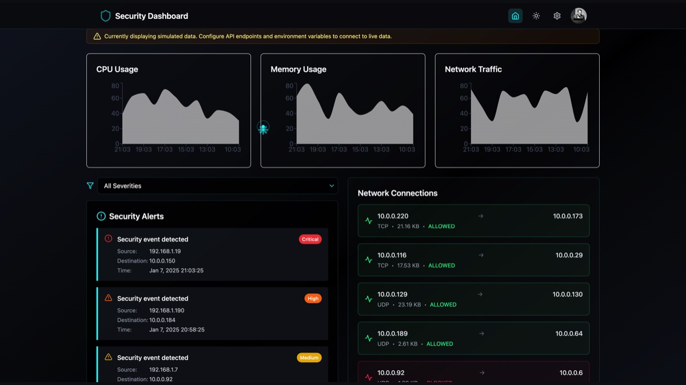
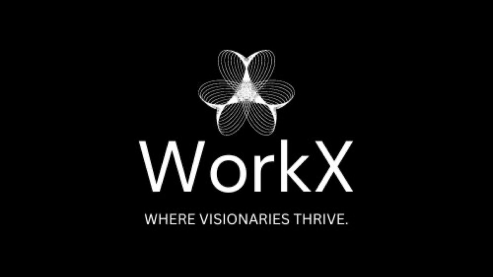
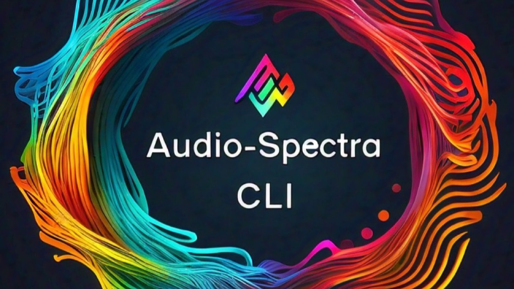
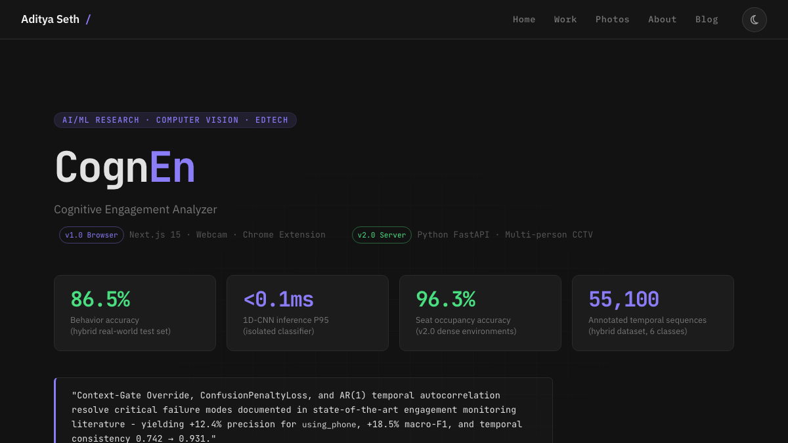
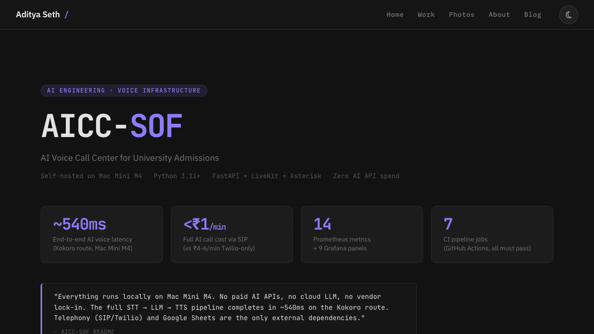
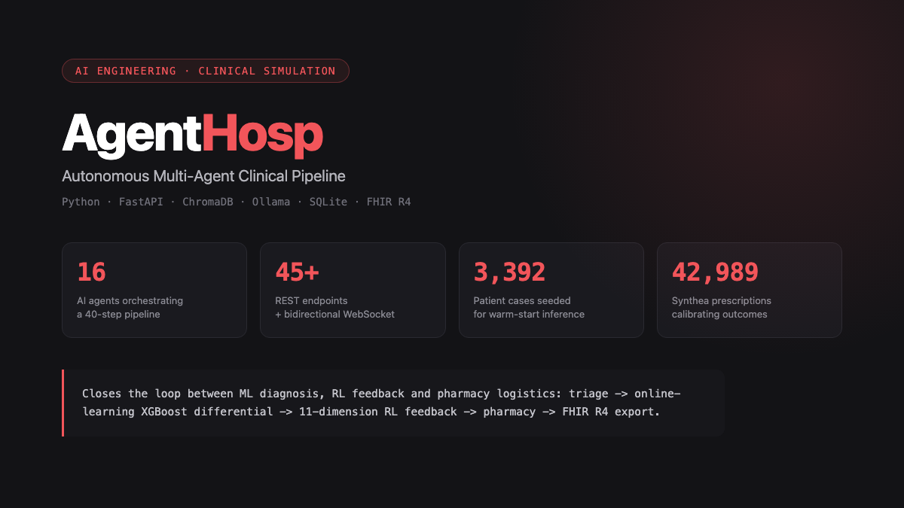
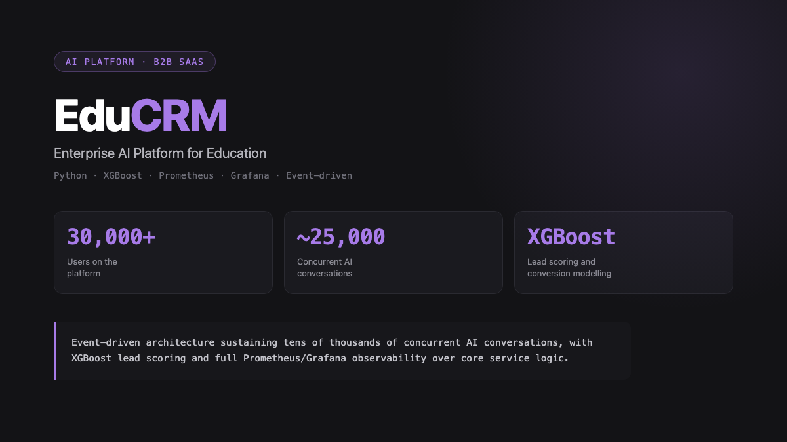
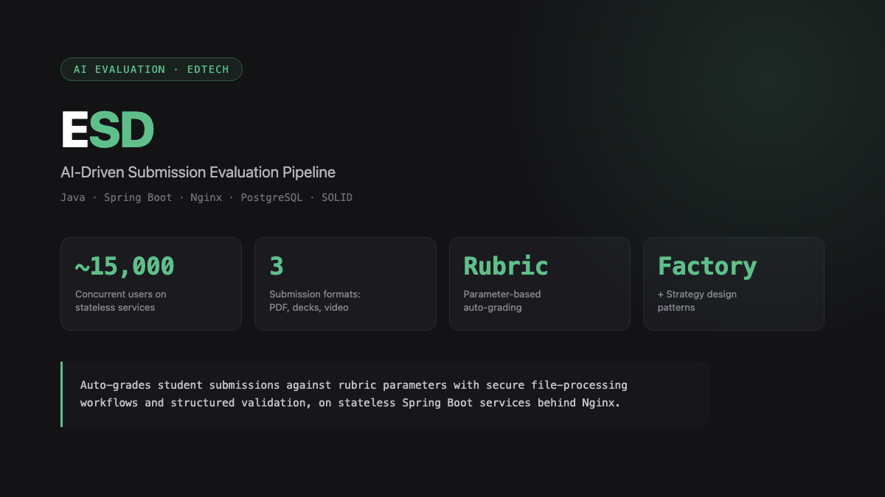
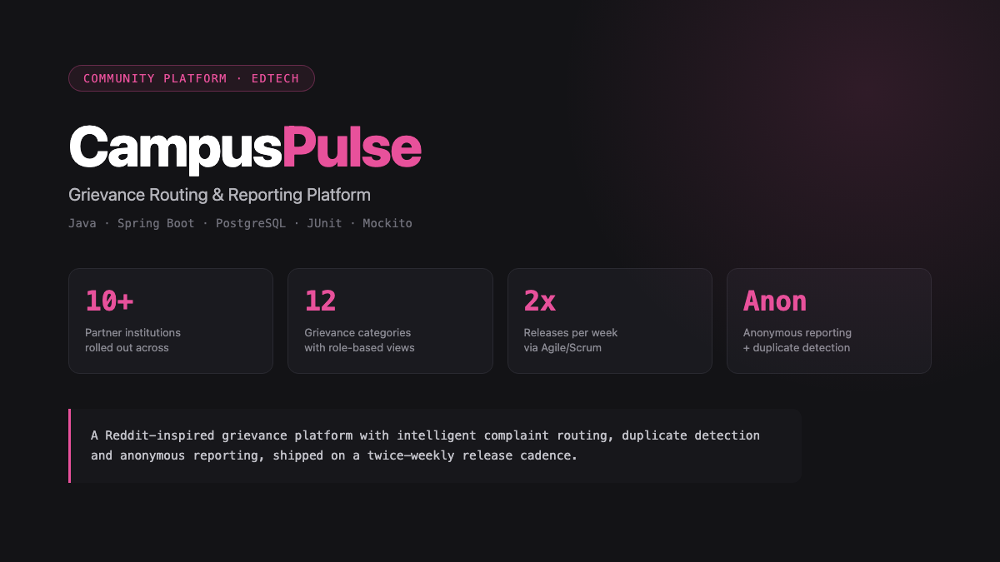

<p align="center">
  
</p>

## Click here to visit my website -> [(www.adityaseth.in)](https://adityaseth.in)


</a>
<a href="https://github.com/AdityaSeth777?tab=followers"></a>
<a href ="https://metrics.lecoq.io/insights/AdityaSeth777"></a>

</p>

```python
Name = "Aditya Seth", "আদিত্য সেঠ", "आदित्य सेठ"
```

### Languages & Tech Stack

<table align="center">
<tr><td align="right"><b>Languages</b></td><td></td></tr>
<tr><td align="right"><b>Backend&nbsp;&&nbsp;APIs</b></td><td></td></tr>
<tr><td align="right"><b>Frontend</b></td><td></td></tr>
<tr><td align="right"><b>Data</b></td><td></td></tr>
<tr><td align="right"><b>Cloud&nbsp;&&nbsp;Infra</b></td><td></td></tr>
<tr><td align="right"><b>Observability&nbsp;&&nbsp;CI</b></td><td></td></tr>
<tr><td align="right"><b>ML&nbsp;&&nbsp;AI</b></td><td></td></tr>
<tr><td align="right"><b>Tools</b></td><td></td></tr>
<tr><td align="right"><b>Operating&nbsp;systems</b></td><td></td></tr>
<tr><td align="right"><b>Interests</b></td><td>


</td></tr>
</table>

<table align="center">
<tr><td align="right"><b>ML&nbsp;runtime&nbsp;&&nbsp;vision</b></td><td>
&nbsp;
&nbsp;
&nbsp;
&nbsp;

</td></tr>
<tr><td align="right"><b>LLM&nbsp;&&nbsp;RAG</b></td><td>
&nbsp;
&nbsp;

</td></tr>
<tr><td align="right"><b>Platform&nbsp;&&nbsp;protocols</b></td><td>
&nbsp;
&nbsp;
&nbsp;
&nbsp;
&nbsp;

</td></tr>
<tr><td align="right"><b>Testing</b></td><td>
&nbsp;
&nbsp;

</td></tr>
</table>

<div align=center>

[](https://github.com/AdityaSeth777)
</div>

## 💼 Experience

| Role | Company | Duration |
|---|---|---|
| 🚀 Software Engineer II (L3), Data & AI | Red Hat, IBM — Pune | Oct 2026 – Present |
| 🧠 Software, Strategy & AI Initiatives Lead | Techno India Group | Aug 2025 – Oct 2026 |
| 🔬 Research Engineer | iHUB DivyaSampark, IIT Roorkee | Oct 2025 – Oct 2026 |
| 💻 SWE Intern | Techno Billion AI | Mar 2025 – Sep 2025 |
| 🛠️ SDE Intern | Oriens InfoTech Pvt. Ltd. (Remote) | Apr 2024 – Jan 2025 |
| 🌐 Freelance Developer | Remote — US Clients | Oct 2022 – Sep 2024 |

### Wanna listen to what I am listening to ? :)

<div align=center> 
  
[](https://spotify-github-profile.kittinanx.com/api/view?uid=setha4195&redirect=true)
  
</div>

## 💻 My workforce

| Machine | Specs |
|---|---|
| 🖥️ **Desktop** |     |
| 💻 **MacBook Pro M4 Max** |   |
| 🖥️ **Mac Mini M4** |   |
| 💻 **MacBook Air M2** |   |

## 📜 Certifications

<div align=center>

[](https://google.accredible.com/e87df4fd-6ae8-4d19-8bc1-3bc50e3cf2da)
-informational?style=flat&logo=data:image/svg%2Bxml;base64,PHN2ZyB4bWxucz0iaHR0cDovL3d3dy53My5vcmcvMjAwMC9zdmciIHZpZXdCb3g9IjAgMCAyNCAyNCI%2BPHBhdGggZmlsbD0iI2ZmZiIgZD0iTTAgMGgxMXYxMUgwem0xMyAwaDExdjExSDEzek0wIDEzaDExdjExSDB6bTEzIDBoMTF2MTFIMTN6Ii8%2BPC9zdmc%2B&logoColor=white&color=737373)
-informational?style=flat&logo=data:image/svg%2Bxml;base64,PHN2ZyB4bWxucz0iaHR0cDovL3d3dy53My5vcmcvMjAwMC9zdmciIHZpZXdCb3g9IjAgMCAyNCAyNCI%2BPHBhdGggZmlsbD0iI2ZmZiIgZD0iTTAgMGgxMXYxMUgwem0xMyAwaDExdjExSDEzek0wIDEzaDExdjExSDB6bTEzIDBoMTF2MTFIMTN6Ii8%2BPC9zdmc%2B&logoColor=white&color=737373)
-informational?style=flat&logo=data:image/svg%2Bxml;base64,PHN2ZyB4bWxucz0iaHR0cDovL3d3dy53My5vcmcvMjAwMC9zdmciIHZpZXdCb3g9IjAgMCAyNCAyNCI%2BPHBhdGggZmlsbD0iI2ZmZiIgZD0iTTAgMGgxMXYxMUgwem0xMyAwaDExdjExSDEzek0wIDEzaDExdjExSDB6bTEzIDBoMTF2MTFIMTN6Ii8%2BPC9zdmc%2B&logoColor=white&color=737373)
-informational?style=flat&logo=data:image/svg%2Bxml;base64,PHN2ZyB4bWxucz0iaHR0cDovL3d3dy53My5vcmcvMjAwMC9zdmciIHZpZXdCb3g9IjAgMCAyNCAyNCI%2BPHBhdGggZmlsbD0iI2ZmZiIgZD0iTTAgMGgxMXYxMUgwem0xMyAwaDExdjExSDEzek0wIDEzaDExdjExSDB6bTEzIDBoMTF2MTFIMTN6Ii8%2BPC9zdmc%2B&logoColor=white&color=737373)
-informational?style=flat&logo=data:image/svg%2Bxml;base64,PHN2ZyB4bWxucz0iaHR0cDovL3d3dy53My5vcmcvMjAwMC9zdmciIHZpZXdCb3g9IjAgMCAyNCAyNCI%2BPGVsbGlwc2UgY3g9IjEyIiBjeT0iMTIiIHJ4PSIxMC40IiByeT0iNS42IiBmaWxsPSJub25lIiBzdHJva2U9IiNmZmYiIHN0cm9rZS13aWR0aD0iMy40Ii8%2BPC9zdmc%2B&logoColor=white&color=F80000)
-informational?style=flat&logo=data:image/svg%2Bxml;base64,PHN2ZyB4bWxucz0iaHR0cDovL3d3dy53My5vcmcvMjAwMC9zdmciIHZpZXdCb3g9IjAgMCAyNCAyNCI%2BPGVsbGlwc2UgY3g9IjEyIiBjeT0iMTIiIHJ4PSIxMC40IiByeT0iNS42IiBmaWxsPSJub25lIiBzdHJva2U9IiNmZmYiIHN0cm9rZS13aWR0aD0iMy40Ii8%2BPC9zdmc%2B&logoColor=white&color=F80000)
-informational?style=flat&logo=data:image/svg%2Bxml;base64,PHN2ZyB4bWxucz0iaHR0cDovL3d3dy53My5vcmcvMjAwMC9zdmciIHZpZXdCb3g9IjAgMCAyNCAyNCI%2BPGVsbGlwc2UgY3g9IjEyIiBjeT0iMTIiIHJ4PSIxMC40IiByeT0iNS42IiBmaWxsPSJub25lIiBzdHJva2U9IiNmZmYiIHN0cm9rZS13aWR0aD0iMy40Ii8%2BPC9zdmc%2B&logoColor=white&color=F80000)

</div>

## 🏆 Achievements & Community

<div align=center>

[-informational?style=flat&logo=leetcode&logoColor=white&color=FFA116)](https://leetcode.com/u/AdityaSethX/)
[](https://adityaseth.in/about)
-informational?style=flat&logo=data:image/svg%2Bxml;base64,PHN2ZyB4bWxucz0iaHR0cDovL3d3dy53My5vcmcvMjAwMC9zdmciIHZpZXdCb3g9IjAgMCAyNCAyNCI%2BPHBhdGggZmlsbD0iI2ZmZiIgZD0iTTAgMGgxMXYxMUgwem0xMyAwaDExdjExSDEzek0wIDEzaDExdjExSDB6bTEzIDBoMTF2MTFIMTN6Ii8%2BPC9zdmc%2B&logoColor=white&color=737373)

[](https://adityaseth.in/medal)
[](https://www.hackerrank.com/AdityaSeth777)
[](https://www.codechef.com/users/adityaseth_cse)


</div>

**Community roles:**
- 🥇 **Gold MLSA** (Top 5%): 2,800+ students mentored since Oct 2022; co-founded Microsoft Aurora Kolkata; Technical Lead, MLSA Nexus Chapter
- 🌐 **[GDG On-Campus TMSL](https://gdg.community.dev/gdg-on-campus-techno-main-salt-lake-kolkata-india/)**: Lead Organizer / DevOps Lead, 750+ members, since Nov 2022
- 📮 **Postman Community Kolkata**: Co-organizer, since Jan 2025
- ☁️ **[GDG Cloud Kolkata](https://gdg.community.dev/gdg-cloud-kolkata/)**: Volunteer, since May 2023
- 🤖 **ML Kolkata** (formerly TensorFlow User Group Kolkata): Member, since Aug 2023
- ⛅ **[CNCF Hooghly](https://community.cncf.io/cloud-native-hooghly/)**: Core team, Aug 2023 to Apr 2024
- 👨‍💻 **[GeeksforGeeks](https://www.geeksforgeeks.org/user/adityaseth_777/) Campus Rep**: Sep 2022 to Oct 2023

## 📸 Hobbies

<div align=center>

[](https://www.instagram.com/perhaps.aditya/)


</div>

Beyond the camera, I spend my off-hours digging into **cryptography** puzzles and problem-solving challenges, and occasionally moonlighting as a **graphic editor** on side projects.

## 🚀 Projects

### 🌍 Open source

<table>
<tr>
<td width="33%" valign="top">
<a href="https://github.com/AdityaSeth777/ShieldK8s"></a>
<br/><a href="https://github.com/AdityaSeth777/ShieldK8s"><b>ShieldK8s</b></a>
<br/><sub>Kubernetes-native security framework: runtime threat monitoring, RBAC enforcement, anomaly detection and CVE scanning, with eBPF syscall tracing for zero-overhead visibility.</sub>
<br/><br/><a href="https://github.com/AdityaSeth777/ShieldK8s"></a>
<a href="https://github.com/AdityaSeth777/ShieldK8s"></a>
<br/>
</td>
<td width="33%" valign="top">
<a href="https://github.com/AdityaSeth777/WorkX"></a>
<br/><a href="https://github.com/AdityaSeth777/WorkX"><b>WorkX</b></a>
<br/><sub>Freelancer-to-business job portal on Django REST + React, with Elasticsearch DSL full-text matching, dual auth (Google Sign-In + JWT) and Firebase, on AWS Elastic Beanstalk.</sub>
<br/><br/><a href="https://github.com/AdityaSeth777/WorkX"></a>
<a href="https://github.com/AdityaSeth777/WorkX"></a>
<br/>
</td>
<td width="33%" valign="top">
<a href="https://github.com/AdityaSeth777/Audio-SpectraCLI"></a>
<br/><a href="https://github.com/AdityaSeth777/Audio-SpectraCLI"><b>Audio-SpectraCLI</b></a>
<br/><sub>Real-time audio spectrum analyzer: FFT visualisation of streaming microphone capture. Published on <a href="https://pypi.org/project/Audio-SpectraCLI/">PyPI</a> and as a <a href="https://marketplace.visualstudio.com/items?itemName=AdityaSeth777.audio-spectracli-extension">VS Code extension</a>.</sub>
<br/><br/><a href="https://github.com/AdityaSeth777/Audio-SpectraCLI"></a>
<a href="https://pypi.org/project/Audio-SpectraCLI/"></a>
<br/>
</td>
</tr>
</table>

### 🔒 Private / proprietary

> Built under research, employer or client engagements, so the source isn't publicly hosted. 📧 [Request access or a walkthrough](mailto:contact@adityaseth.in)

<table>
<tr>
<td width="33%" valign="top">
<a href="https://adityaseth.in/projects/aiccandcognen/cognen"></a>
<br/><a href="https://adityaseth.in/projects/aiccandcognen/cognen"><b>CognEn</b></a>
<br/><sub>Cognitive engagement analyzer built at IIT Roorkee. Chrome MV3 client (YOLOv8-nano ONNX + MediaPipe) plus a FastAPI server for multi-person CCTV.</sub>
<br/><br/>


<br/>
</td>
<td width="33%" valign="top">
<a href="https://adityaseth.in/projects/aiccandcognen/aicc-sof"></a>
<br/><a href="https://adityaseth.in/projects/aiccandcognen/aicc-sof"><b>AICC-SOF</b></a>
<br/><sub>AI voice call center for university admissions, self-hosted on a Mac Mini M4. Local STT/LLM/TTS over FastAPI + LiveKit + Asterisk, with zero AI API spend.</sub>
<br/><br/>


<br/>
</td>
<td width="33%" valign="top">

<br/><b>AgentHosp</b>
<br/><sub>16 AI agents orchestrating a 40-step hospital pipeline: triage, online-learning XGBoost differential diagnosis, an 11-dimension RL feedback loop, pharmacy and FHIR R4 export.</sub>
<br/><br/>


<br/>
</td>
</tr>
<tr>
<td width="33%" valign="top">

<br/><b>EduCRM</b>
<br/><sub>Enterprise B2B SaaS AI platform. Event-driven architecture with XGBoost lead scoring and Prometheus/Grafana observability.</sub>
<br/><br/>

<br/>
</td>
<td width="33%" valign="top">

<br/><b>ESD</b>
<br/><sub>AI-driven evaluation pipeline that auto-grades student submissions (PDFs, decks, video) against rubric parameters, on stateless Spring Boot services behind Nginx.</sub>
<br/><br/>

<br/>
</td>
<td width="33%" valign="top">

<br/><b>SOF CP (Campus Pulse)</b>
<br/><sub>Reddit-inspired grievance platform with intelligent complaint routing, duplicate detection, anonymous reporting and role-based dashboards.</sub>
<br/><br/>

<br/>
</td>
</tr>
</table>


## ✍️ Latest blog posts

<table>
<tr>
<td width="33%" valign="top">
<a href="https://adityaseth.in/blog/gemini-api-structured-output-vs-function-calling"></a>
<br/><a href="https://adityaseth.in/blog/gemini-api-structured-output-vs-function-calling"><b>Structured Output vs Function Calling for Extraction in the Gemini API</b></a>
<br/><sub>Oct 24, 2026</sub>
</td>
<td width="33%" valign="top">
<a href="https://adityaseth.in/blog/training-segmentation-model-colab-tpu-litert-android"></a>
<br/><a href="https://adityaseth.in/blog/training-segmentation-model-colab-tpu-litert-android"><b>Training a Segmentation Model on a Colab TPU and Exporting to LiteRT for Android</b></a>
<br/><sub>Oct 20, 2026</sub>
</td>
<td width="33%" valign="top">
<a href="https://adityaseth.in/blog/firebase-ai-logic-app-check-gemini-mobile-quota"></a>
<br/><a href="https://adityaseth.in/blog/firebase-ai-logic-app-check-gemini-mobile-quota"><b>Shipping Gemini in a Mobile App Without Leaking Your Quota</b></a>
<br/><sub>Oct 13, 2026</sub>
</td>
</tr>
<tr>
<td width="33%" valign="top">
<a href="https://adityaseth.in/blog/gemini-api-safety-regression-gate-model-version-bumps"></a>
<br/><a href="https://adityaseth.in/blog/gemini-api-safety-regression-gate-model-version-bumps"><b>A CI Safety Regression Gate for Gemini API Model Version Bumps</b></a>
<br/><sub>Oct 10, 2026</sub>
</td>
<td width="33%" valign="top">
<a href="https://adityaseth.in/blog/bigquery-vector-search-multitenant-recall"></a>
<br/><a href="https://adityaseth.in/blog/bigquery-vector-search-multitenant-recall"><b>Multitenant Vector Search in BigQuery ML: Why Tenant Pre-Filtering Tanks Recall</b></a>
<br/><sub>Oct 07, 2026</sub>
</td>
<td width="33%" valign="top">
<a href="https://adityaseth.in/blog/mediapipe-hand-tracking-gloves-model-maker-limits"></a>
<br/><a href="https://adityaseth.in/blog/mediapipe-hand-tracking-gloves-model-maker-limits"><b>MediaPipe Hand Tracking Fails on Gloved Hands, and Model Maker Only Fixes Half of It</b></a>
<br/><sub>Sep 28, 2026</sub>
</td>
</tr>
</table>

<p align="center"><a href="https://adityaseth.in/blog"><b>Read all posts on adityaseth.in/blog</b></a></p>

### Connect with me:

<div align=center>

<a href="https://www.linkedin.com/in/adityaseth777/" title="LinkedIn"></a> &nbsp;
<a href="mailto:contact@adityaseth.in" title="Email"></a> &nbsp;
<a href="https://x.com/AdityaSeth777" title="X / Twitter"></a> &nbsp;
<a href="https://www.instagram.com/perhaps.aditya/" title="Instagram"></a> &nbsp;
<a href="https://youtube.com/@adityaseth777" title="YouTube"></a> &nbsp;
<a href="https://adityaseth.in/blog" title="Blog"></a> &nbsp;
<a href="https://medium.com/@adityaseth777" title="Medium"></a> &nbsp;
<a href="https://adityaseth.in/discord" title="Discord"></a>
<br/>
<a href="https://leetcode.com/u/AdityaSethX/" title="LeetCode"></a> &nbsp;
<a href="https://www.hackerrank.com/AdityaSeth777" title="HackerRank"></a> &nbsp;
<a href="https://www.codechef.com/users/adityaseth_cse" title="CodeChef"></a> &nbsp;
<a href="https://www.geeksforgeeks.org/user/adityaseth_777/" title="GeeksforGeeks"></a> &nbsp;
<a href="https://adityaseth.in/gcp-directory" title="Google Cloud Skills Boost"></a> &nbsp;
<a href="https://holopin.io/@adityaseth777" title="Holopin"></a> &nbsp;
<a href="https://www.quora.com/profile/Aditya-Seth-133" title="Quora"></a> &nbsp;
<a href="https://tracker.gg/valorant/profile/riot/BabuWhere%23dimun/overview" title="Valorant — Riot ID: BabuWhere#dimun"></a> &nbsp;
<a href="https://steamcommunity.com/id/adityaseth777" title="Steam"></a>

  </div>

## 💻 My explored OS's :)


### LeetCode Stats :

<div align="center">

<a href="https://leetcode.com/u/AdityaSethX/"></a>


</div>

### Statistics :

<div align="center">
   <a href="https://github.com/AdityaSeth777">
 
   
   </a>
   <a href="https://github.com/AdityaSeth777">
   
   <br/>
   </a>
</div>
 
<div align=center> 
<p></p>
</div>

<div align=center>
   <a href="https://github.com/AdityaSeth777" target="_blank">
   
   </a>
</div> 
<div align=center>
   <a href="https://github.com/AdityaSeth777">
   
   
</div>

<div align=center>            
   <a href="https://github.com/AdityaSeth777">
   
   
   </a>
</div>

## 🐍 Contribution Snake

<div align=center>

<picture>
  <source media="(prefers-color-scheme: dark)" srcset="https://raw.githubusercontent.com/AdityaSeth777/AdityaSeth777/output/github-contribution-grid-snake-dark.svg" />
  <source media="(prefers-color-scheme: light)" srcset="https://raw.githubusercontent.com/AdityaSeth777/AdityaSeth777/output/github-contribution-grid-snake.svg" />
  
</picture>

</div>

[](https://holopin.io/@adityaseth777)

<!--
[](https://github.com/AdityaSeth777/github-readme-activity-graph)

!-->

[](https://github.com/AdityaSeth777/github-profile-trophy)
